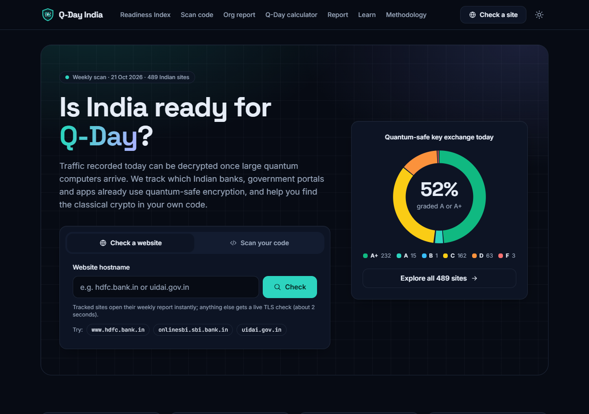
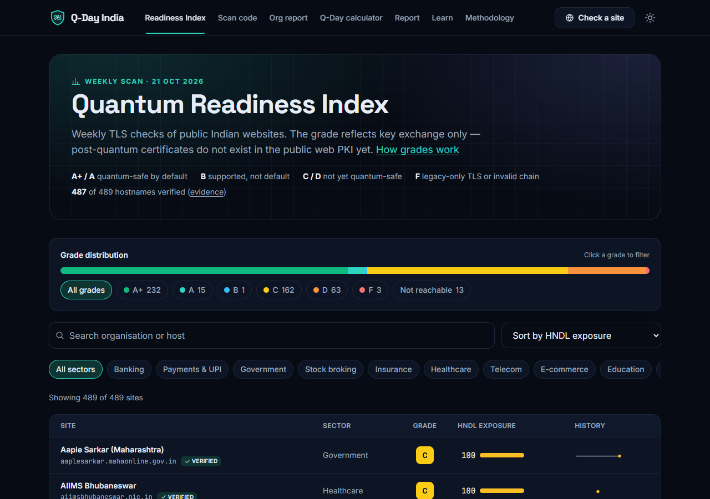
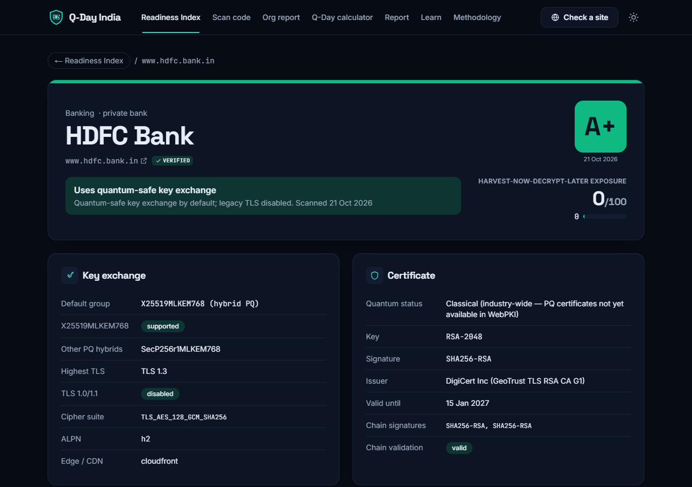
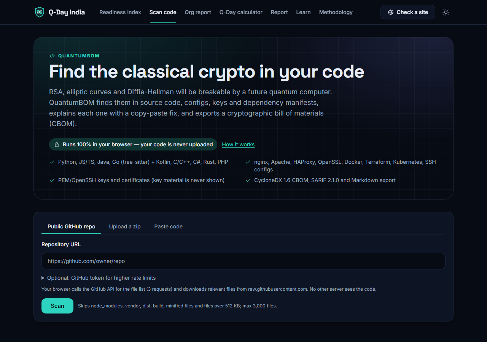
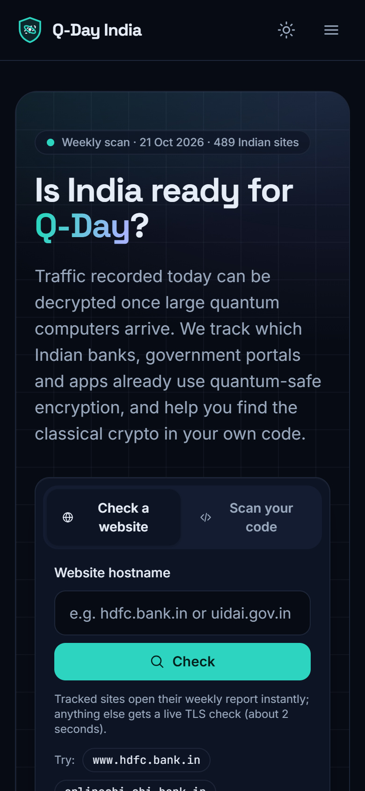
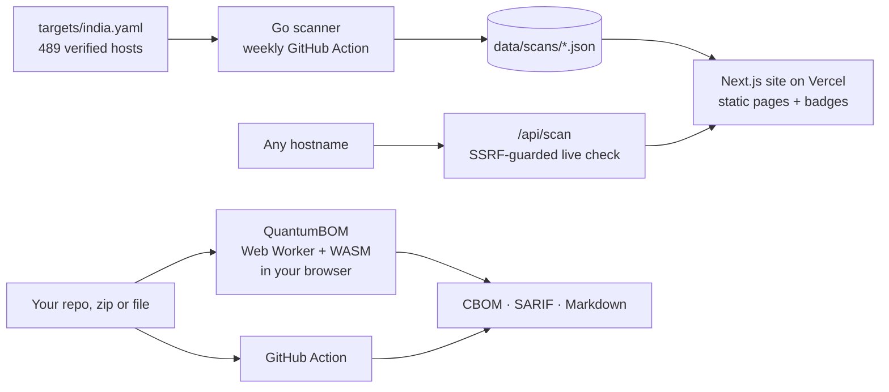

<div align="center">


# Q-Day India

**Scan India's websites and your code for quantum risk — then fix it.**

[](https://github.com/JyotirmoyLaha/Q-Day-India/actions/workflows/ci.yml)
[](https://github.com/JyotirmoyLaha/Q-Day-India/actions/workflows/weekly-scan.yml)
[](https://q-day-india.vercel.app/code)
[](LICENSE)
[](data/)

[**🌐 Live site**](https://q-day-india.vercel.app) ·
[**📊 Readiness Index**](https://q-day-india.vercel.app/readiness) ·
[**🔍 Scan your code**](https://q-day-india.vercel.app/code) ·
[**📖 Methodology**](https://q-day-india.vercel.app/about)

<br>

<picture>
  <source media="(prefers-color-scheme: light)" srcset="docs/screenshots/home-light.png">
  
</picture>

</div>

---

## Why this exists

A large enough quantum computer running Shor's algorithm will break RSA, Diffie-Hellman and elliptic-curve
cryptography. That day is often called **Q-Day**. Attackers don't have to wait for it: traffic can be
**recorded today and decrypted later** (*harvest now, decrypt later*). So data that has to stay secret for
years, such as bank, health, tax and identity records, needs post-quantum protection now.

Q-Day India measures both halves of the migration to post-quantum cryptography (PQC):

<table>
<tr>
<td width="50%" valign="top">

### 🏛️ Sites — Quantum Readiness Index

Which Indian banks, government portals, payment apps and universities already use **quantum-safe TLS key
exchange** (`X25519MLKEM768`)?

A Go scanner checks every site weekly on GitHub Actions, and a live check runs on a Vercel function.

</td>
<td width="50%" valign="top">

### 🧬 Code — QuantumBOM

Where in **my code** is classical public-key crypto, and how do I replace it?

It runs **100% in your browser** (Web Worker + WebAssembly tree-sitter) or as a **GitHub Action**. Your code is never uploaded.

</td>
</tr>
</table>

## At a glance

<div align="center">

| 🌐 Sites tracked | ✅ Verified owners | 🔐 Quantum-safe today | 📏 Code rules | 🛠️ Fix guides | 💸 Running cost |
|:---:|:---:|:---:|:---:|:---:|:---:|
| **489** | **487** | **52%** graded A/A+ | **82** | **31** | **₹0** (free tiers) |

<sub>From the 2026-10-22 scan. Numbers update every week; see the <a href="https://q-day-india.vercel.app/report">monthly report</a>.</sub>

</div>

## Screenshots

<table>
<tr>
<td width="50%"><a href="https://q-day-india.vercel.app/readiness"></a><p align="center"><b>Readiness Index</b>: filter 489 sites by grade and sector</p></td>
<td width="50%"><a href="https://q-day-india.vercel.app/site/www.hdfc.bank.in"></a><p align="center"><b>Site report</b>: every probe, certificate, history and fixes</p></td>
</tr>
<tr>
<td width="50%"><a href="https://q-day-india.vercel.app/code"></a><p align="center"><b>QuantumBOM</b>: scan a repo, zip or file in your browser</p></td>
<td width="50%" align="center"><p align="center"><b>Works on phones</b>, in light and dark themes</p></td>
</tr>
</table>

## Features

### Readiness Index
- **489 Indian hosts in 10 sectors**: banking, payments, government, stock broking, insurance, healthcare,
  telecom, e-commerce, education and media. Each has grade history, sector charts and fix guidance.
- **Verified ownership:** 487 hostnames are tied to their organisation by homepage, certificate, restricted
  registries (`.bank.in`, `.gov.in`, `.ac.in`) or Wikidata. All the evidence is public in
  [`targets/VERIFICATION.md`](targets/VERIFICATION.md).
- **Five TLS probes + one HEAD per host:** default handshake, PQ-only, alternative hybrids
  (`SecP256r1MLKEM768` / `SecP384r1MLKEM1024`), TLS 1.3-only and legacy TLS 1.0/1.1, plus HSTS and CDN
  detection. Slow sites get a retry, and old servers get a compatibility handshake.
- **Live check** of any public hostname (`/check`, `/api/scan`) behind strict SSRF protection: hostname-only
  input, IDN → punycode, every resolved address must be public, and the connection goes to the validated IP.

### QuantumBOM
- **Scan a public GitHub repo, a zip or a pasted file.** 82 data-driven rules cover Python, JS/TS/TSX, Java and Go
  (tree-sitter), and Kotlin, Scala, C/C++, C#, Rust and PHP (regex). It also checks nginx, Apache, HAProxy, OpenSSL,
  Docker, Terraform, Kubernetes and SSH configs, key files (key material is never shown) and dependency manifests.
- **Standard exports:** CycloneDX 1.6 **CBOM**, **SARIF 2.1.0** and **Markdown**, all validated against the
  official schemas. Reports can be shared through the URL fragment, which no server ever sees.
- **31 dated fix guides** with before/after code: OpenSSL 3.5 with nginx/Apache/HAProxy, Go `crypto/mlkem` and
  `crypto/mldsa`, Node 24 `ml-kem-768`, JDK ML-KEM/ML-DSA, pyca/cryptography ≥ 48, AWS `*-PQ-2025-09` policies,
  OpenSSH 10 and more.

### And more
- 🏢 **Organisation report** mapped to India's DST Task Force quantum-safe roadmap
- ⏳ **Q-Day calculator** based on Mosca's theorem: *are you already late?*
- 📰 **Monthly "State of the Nation" report** with movers
- 🎓 **Learn** page with an interactive Shor's-algorithm demo
- 🏷️ **README badges** for sites and repos

## How it works



### Grades: key exchange only

| Grade | Meaning |
|:---:|---|
| 🟢 **A+** | `X25519MLKEM768` supported **and** negotiated by default; TLS 1.0/1.1 disabled |
| 🟢 **A** | As A+, but TLS 1.0/1.1 still accepted |
| 🔵 **B** | A post-quantum hybrid is supported but not negotiated by default |
| 🟡 **C** | TLS 1.3 without post-quantum key exchange |
| 🟠 **D** | TLS 1.2 is the highest version |
| 🔴 **F** | Only TLS below 1.2, or the certificate chain did not validate |
| ⚪ **—** | Not reachable: the reason is shown and no grade is given |

- **HNDL exposure (0–100)** = `round(100 × exposure × (0.6 × shelf + 0.4 × sector weight))`. It is a
  prioritisation aid, based on how long each sector's data must stay secret.
- **Certificates** are always classical today, because post-quantum certificates don't exist in the WebPKI yet. They never affect the grade.
- **Code scores:** *Quantum Exposure* (weighted findings on a log curve by repo size) and *Crypto-Agility* (how
  centralised hardcoded algorithm choices are).

Full details: [Methodology](https://q-day-india.vercel.app/about) · Responsible scanning and opt-out:
[About the scanner](https://q-day-india.vercel.app/about/scanner)

## Quick start

> **Requirements:** Node.js ≥ 24.5 (bundles OpenSSL 3.5), pnpm 10, Go ≥ 1.26

```bash
pnpm install
pnpm --filter web dev            # http://localhost:3000 (prebuild compiles data, rules and WASM)
pnpm test                        # engine + web tests + scan schema validation
pnpm go:test                     # Go scanner tests (offline)
QDAY_LIVE_TESTS=1 pnpm go:test   # + live TLS tests
```

<details>
<summary><b>Scanner and CLI commands</b></summary>

```bash
# Grade one host
cd scanner && go run ./cmd/qday-scan --host cloudflare.com --json

# Full scan of the target list
go run ./cmd/qday-scan --targets ../targets/india.yaml --out ../data --date 2026-10-22

# QuantumBOM CLI on any directory
node action/dist/cli.mjs scan path/to/repo --cbom out.cdx.json --sarif out.sarif --md out.md
```

On the development machine, toolchains, caches and temp files live in a git-ignored project-local environment:
`source ./activate.sh` (bash) or `. .\activate.ps1` (PowerShell).

</details>

## Use it in your project

### GitHub Action

Findings go to GitHub Code Scanning, and the CBOM is uploaded as a build artifact.

```yaml
permissions: { contents: read, security-events: write }
jobs:
  cbom:
    runs-on: ubuntu-latest
    steps:
      - uses: actions/checkout@v7
      - uses: JyotirmoyLaha/Q-Day-India/action@v1
        with:
          exclude: 'test/fixtures/**'
          fail-above: '80'   # optional: fail the build above this exposure score
```

See [action/README.md](action/README.md) for every input and output.

### Badges

| Badge | Markdown |
|---|---|
| [](https://q-day-india.vercel.app/site/www.hdfc.bank.in) | `` |
| [](https://q-day-india.vercel.app/code) | `` |

Badges are served from the latest weekly data and cached by the CDN. Viewing a badge never triggers a scan.

## Repository layout

```
apps/web/               Next.js 16 (App Router, TypeScript, Tailwind v4, Recharts): pages, /api/scan, /api/badge
packages/cbom-engine/   QuantumBOM engine: rules/*.yaml, fixes/*.md, exporters, CLI, fixtures
scanner/                Go TLS scanner (qday-scan)
action/                 Composite GitHub Action + bundled CLI (dist/)
targets/                india.yaml target list, VERIFICATION.md evidence, optout.txt
data/                   latest.json, scans/YYYY-MM-DD.json history, repos/*.json badge data
schemas/                scan.schema.json and grading parity cases shared by Go and TypeScript
.github/workflows/      ci.yml, weekly-scan.yml, on-demand.yml
```

## Limitations

- TLS checks see only the public edge (often a CDN), not internal or back-end connections.
- Certificates cannot be post-quantum yet, so grades reflect key exchange only.
- Some government and bank hosts block or rate-limit automated or foreign traffic. Hosts that still fail after the
  retry pass are shown as *not reachable* with the reason, never graded.
- Static code analysis has false positives and misses algorithms chosen at runtime; every finding shows a
  confidence level.
- Quantum-computer timelines are uncertain, so the Q-Day calculator lets you choose your own estimate.

## Contributing

Corrections to the target list are the most valuable contribution. Open a PR that fixes a hostname or adds
evidence to [`targets/VERIFICATION.md`](targets/VERIFICATION.md). Rules are YAML
(`packages/cbom-engine/rules/`) and fixes are Markdown (`packages/cbom-engine/fixes/`); each rule needs a fixture
line marked `expect: <rule-id>`.

Please keep to the wording rules: describe sites as *"not yet quantum-safe"*, never as "vulnerable" or "hacked".
CI enforces this.

<details>
<summary><b>Sources</b></summary>

- DST Task Force, *Implementation of Quantum Safe Ecosystem in India* (Feb 2026): <https://dst.gov.in/quantum-safe-ecosystem-in-india>
- NIST FIPS 203 (ML-KEM), 204 (ML-DSA), 205 (SLH-DSA): <https://csrc.nist.gov/pubs/fips/203/final>
- RFC 10024, hybrid ML-KEM key agreement for TLS 1.3: <https://www.rfc-editor.org/info/rfc10024>
- OpenSSL 3.5: <https://github.com/openssl/openssl/releases> · Go X25519MLKEM768: <https://github.com/golang/go/issues/69985>
- Cloudflare PQC support matrix: <https://developers.cloudflare.com/ssl/post-quantum-cryptography/pqc-support/>
- CycloneDX 1.6: <https://cyclonedx.org/docs/1.6/json/> · SARIF 2.1.0: <https://docs.oasis-open.org/sarif/sarif/v2.1.0/>

</details>

## License

Code: [MIT](LICENSE). Scan data in `data/`: [CC BY 4.0](https://creativecommons.org/licenses/by/4.0/).

<div align="center">
<sub>Built for India's post-quantum migration · <a href="https://q-day-india.vercel.app">q-day-india.vercel.app</a></sub>
</div>
